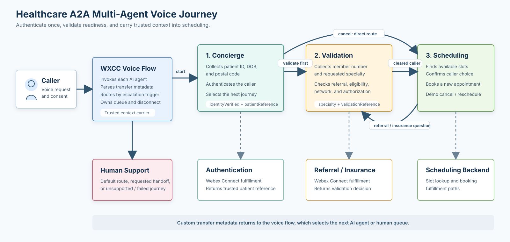
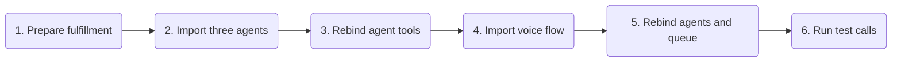
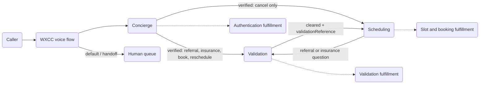

# Healthcare A2A Multi-Agent Voice Orchestration

This reference playbook uses three autonomous voice AI agents to authenticate a patient, validate referral and insurance readiness, and complete an appointment journey. A Webex Contact Center voice flow carries trusted context between agents and routes unresolved calls to human support.

## What This Playbook Demonstrates

| Agent | Responsibility | Key result |
|---|---|---|
| **Healthcare Concierge** | Authenticates the caller and identifies the requested journey. | Produces `identityVerified` and `patientReference`, then routes the caller. |
| **Referral and Insurance Validation** | Collects the insurance member number and specialty, then evaluates readiness. | Produces `specialty` and `validationReference` when the caller is cleared. |
| **Healthcare Scheduling** | Finds and books a new appointment. It also demonstrates cancellation and rescheduling responses. | Confirms a booking or completes the configured demo-only cancellation/rescheduling path. |
| **Voice flow** | Parses transfer metadata and selects the next AI agent or human queue. | Preserves the journey across agent boundaries. |

## Try It Fast

1. Import and publish the included Webex Connect fulfillment flows:
   1. [98941.workflow](assets/98941.workflow) - patient authentication
   2. [99610.workflow](assets/99610.workflow) - referral and insurance validation
   3. [98942.workflow](assets/98942.workflow) - appointment slot lookup
   4. [98943.workflow](assets/98943.workflow) - appointment management
2. Import the AI Agent Studio exports in this order:
   1. [HealthCare_Concierge.json](assets/HealthCare_Concierge.json)
   2. [HealthCare_Insurance_Validation.json](assets/HealthCare_Insurance_Validation.json)
   3. [HealthCare_Scheduling_v2.json](assets/HealthCare_Scheduling_v2.json)
3. Rebind each fulfillment tool to the corresponding published Webex Connect flow in the target tenant.
4. Import [Healthcare_A2A_Multi_Agent_voice_Flow.json](assets/Healthcare_A2A_Multi_Agent_voice_Flow.json) into Flow Designer.
5. Rebind the three Virtual Agent V2 activities to the imported agents and replace the imported human-support queue with the target queue.
6. Review the transfer mappings under [Required Flow Review](#required-flow-review), publish to a test entry point, and run the test script.

## Setup Checklist

- [ ] All four included Webex Connect workflows are imported and published.
- [ ] All three AI agents are imported and published.
- [ ] `Authenticate_Patient`, `Validate_Referral_Insurance`, `Find_Appointment_Slots`, and `Manage_Appointment` point to tenant-local fulfillment flows.
- [ ] The voice flow references the three imported agents.
- [ ] The default branch of `Route_Agent_Transfer` reaches the human-support queue.
- [ ] `identityVerified`, `patientReference`, `specialty`, and `validationReference` are passed to the correct downstream agent.
- [ ] Sensitive fields and transcript retention have been reviewed against the deployment's privacy requirements.

## Journey Rules

### Booking or rescheduling

1. Concierge authenticates the caller.
2. Concierge sends the verified caller to Validation.
3. Validation collects exactly two values: insurance member number and specialty.
4. Validation transfers only a cleared caller to Scheduling.
5. Scheduling books a new appointment through fulfillment. Rescheduling is a demo-only success response in this version.

### Cancellation

1. Concierge authenticates the caller.
2. Concierge sends an authenticated cancellation directly to Scheduling.
3. Scheduling returns the configured demo-only cancellation confirmation without calling a fulfillment tool.

### Human assistance

An explicit request for a person, failed authentication, an unsupported request, an emergency, or an unhandled transfer value follows the human-handoff path. The voice flow's default routing outcome must remain connected to the configured queue.

## Required Flow Review

The supplied exports are reference assets and retain tenant-bound IDs. Complete these checks after import:

The edited flow now parses `identityVerified` and `patientReference` from both Concierge transfer actions, so the direct cancellation path is covered.

1. **Scheduling return metadata:** `Parse_Scheduling_Transfer` currently reads values from `actions.Transfer_To_Scheduling`, while the Scheduling agent emits `Transfer_To_Validation`. Update those JSONPath expressions to use `actions.Transfer_To_Validation`.
2. **Sensitive context:** `patientReference` is not marked secure in the current voice-flow variable or several tool schemas. Apply the target organization's secure-variable policy before production use.
3. **Tenant references:** Rebind AI Agent IDs, queue IDs, Webex Connect flows, service references, webhook endpoints, and credentials. Do not assume imported IDs are portable.

## Test Script

| Scenario | Caller behavior | Expected result |
|---|---|---|
| New booking | Authenticate successfully, request Cardiology, provide the insurance member number, and choose a returned slot. | Validation returns a cleared result and `validationReference`; Scheduling confirms details and books only after explicit approval. |
| Cancellation | Authenticate successfully and ask to cancel an appointment. | Concierge transfers directly to Scheduling; Scheduling gives the demo cancellation confirmation without running validation or appointment fulfillment. |
| Reschedule | Authenticate successfully and request a reschedule. | Caller passes through Validation first; Scheduling gives the configured demo rescheduling confirmation without calling slot or management fulfillment. |
| Validation blocked | Return an expired referral, ineligible coverage, out-of-network status, or required prior authorization. | Validation explains the returned blocker and does not transfer the caller to Scheduling automatically. |
| Validation question during scheduling | Ask an insurance or referral question while speaking with Scheduling. | Scheduling emits `Transfer_To_Validation`; the voice flow returns the caller to Validation with trusted context. |
| Human request | Say, "I want to speak with a person." | The agent uses handoff and the voice flow routes the call to the configured human queue. |

Files In This Playbook

| File | Type | Purpose |
|---|---|---|
| [98941.workflow](assets/98941.workflow) | Webex Connect workflow export | Patient authentication fulfillment used by `Authenticate_Patient`. |
| [99610.workflow](assets/99610.workflow) | Webex Connect workflow export | Referral and insurance validation used by `Validate_Referral_Insurance`. |
| [98942.workflow](assets/98942.workflow) | Webex Connect workflow export | Appointment availability fulfillment used by `Find_Appointment_Slots`. |
| [98943.workflow](assets/98943.workflow) | Webex Connect workflow export | Appointment booking fulfillment used by `Manage_Appointment`. |
| [HealthCare_Concierge.json](assets/HealthCare_Concierge.json) | Autonomous AI Agent export | Authentication, journey selection, and initial specialist routing. |
| [HealthCare_Insurance_Validation.json](assets/HealthCare_Insurance_Validation.json) | Autonomous AI Agent export | Referral and insurance validation plus transfer to Scheduling. |
| [HealthCare_Scheduling_v2.json](assets/HealthCare_Scheduling_v2.json) | Autonomous AI Agent export | Slot lookup, booking, demo cancellation/rescheduling, and validation-question return. |
| [Healthcare_A2A_Multi_Agent_voice_Flow.json](assets/Healthcare_A2A_Multi_Agent_voice_Flow.json) | Webex Contact Center flow export | Multi-agent orchestration, metadata parsing, queue fallback, hold music, and disconnect handling. |
| [agent-configuration-reference.md](docs/agent-configuration-reference.md) | Implementation reference | Transfer payloads, fulfillment contracts, mock responses, and detailed configuration notes. |
| [healthcare-a2a-multi-agent-flow.svg](assets/healthcare-a2a-multi-agent-flow.svg) | Architecture visual | High-level view of the three-agent journey and fulfillment boundaries. |

Architecture And Transfer Contracts

Every specialist-to-specialist transition is implemented as a custom transfer action. The active AI agent exits to the voice flow, the flow parses the agent's `MetaData`, checks `escalation_trigger`, and invokes the selected next agent with trusted event data.

| Handoff | Required data |
|---|---|
| Concierge to Validation | `identityVerified`, `patientReference` |
| Concierge to Scheduling | `identityVerified`, `patientReference`; cancellation only |
| Validation to Scheduling | `identityVerified`, `patientReference`, `specialty`, `validationReference` for booking/rescheduling |
| Validation to Scheduling for cancellation | `identityVerified`, `patientReference` |
| Scheduling to Validation | `identityVerified`, `patientReference` |

Fulfillment And Demo Behavior

The exports include four Webex Connect workflows and reference these fulfillment names:

| Tool | Purpose | Required input |
|---|---|---|
| `Authenticate_Patient` | Verify the caller. | `patientId`, `dateOfBirth`, `postalCode` |
| `Validate_Referral_Insurance` | Evaluate referral and insurance readiness. | `patientReference`, `insuranceMemberId`, `specialty` |
| `Find_Appointment_Slots` | Return appointment options for a new booking. | `patientReference`, `specialty`; preferences are optional |
| `Manage_Appointment` | Confirm a new booking in the current demo instructions. | `operation`, `patientReference`; booking also needs `selectedSlotReference` |

Cancellation and rescheduling deliberately use spoken demo outcomes and do not call `Find_Appointment_Slots` or `Manage_Appointment`. Do not present those paths as production transactions until a real backend operation is added.

See [Agent And Tool Configuration Reference](docs/agent-configuration-reference.md) for request and response examples.

Security, Privacy, And Production Notes

- Treat patient ID, date of birth, postal code, insurance member number, patient reference, validation reference, appointment details, transcripts, and recordings according to the deployment's privacy and retention policies.
- The agent exports mark patient ID, date of birth, postal code, and insurance member number as secure inputs. Review all downstream mappings and logs as well.
- The current exports contain tenant-specific identifiers and Webex Connect references. Preserve the raw exports for importability, but rebind every environment-specific reference after import.
- Do not expose tool failures, internal identifiers, JSON payloads, or backend implementation details to callers.
- Replace demo cancellation and rescheduling responses with authoritative fulfillment before production use.
- Add and validate explicit error paths for unavailable fulfillment, invalid transfer metadata, and queue failure.
- Validate emergency-language handling with the healthcare organization's approved policy; this reference does not provide clinical or emergency advice.

## Validation Performed

- Parsed all four JSON files under `assets/` successfully with `jq`.
- Inspected all AI Agent and Flow Designer exports with the SCG playbook inspector.
- Confirmed that all four referenced Webex Connect workflow exports are present.
- Validated the SVG as well-formed XML.
- Preserved the importable JSON exports without modification.

