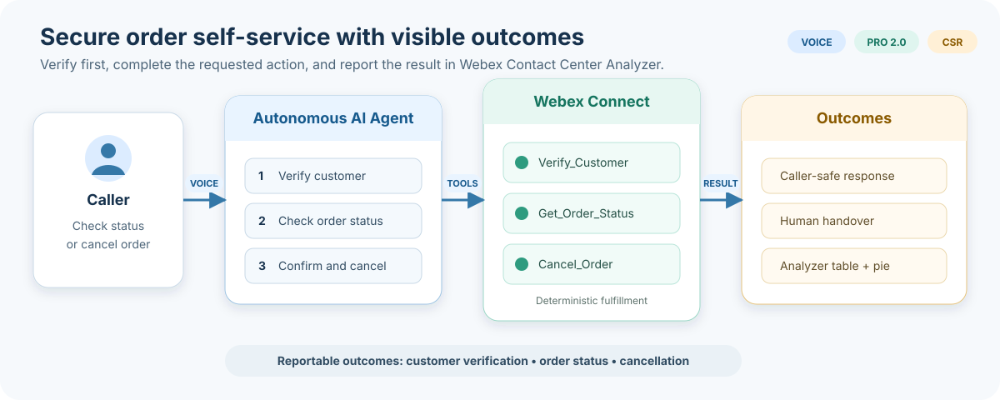
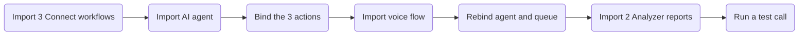
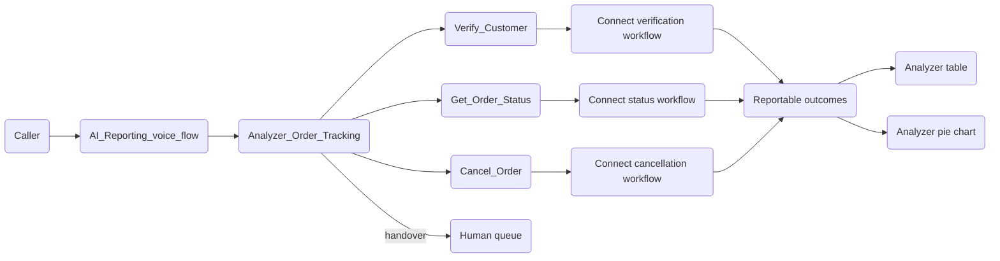

# Analyzer Order Tracking Autonomous AI Agent

Verify callers before exposing order details, let them check or cancel an existing order, and make each action outcome visible in Webex Contact Center Analyzer.

## Try It Fast

1. In Webex Connect, import and publish [101779.workflow](exports/101779.workflow), [101780.workflow](exports/101780.workflow), and [101781.workflow](exports/101781.workflow).
2. In Webex AI Agent Studio, import [Analyzer-order-tracking-ai-agent-studio-import.json](exports/Analyzer-order-tracking-ai-agent-studio-import.json).
3. Bind `Verify_Customer`, `Get_Order_Status`, and `Cancel_Order` to their matching imported Connect workflows. Use the workflow names and input/output contracts shown after import; the numeric export filenames are intentionally preserved.
4. In Webex Contact Center Flow Designer, import [AI_Reporting_voice_flow.json](exports/AI_Reporting_voice_flow.json). Rebind its AI Agent activity and human-support queue; the reference flow uses `Queue-1`.
5. Confirm that the three imported reporting variables below are String, marked **Reportable**, and populated during the interaction.
6. In Analyzer, import both `CSR_*.json` report templates from the [exports](exports/) folder.
7. Place a test call, complete one order-status or cancellation journey, and run both reports after the historical data becomes available.

> Adapting this agent for another order system? The [Webex AI Agent Creator](../../Plugins/webex-ai-agent-creator/README.md) helps rebuild the instructions and action contracts without starting from scratch.

## Setup Checklist

- [ ] Webex Connect workflows imported and published.
- [ ] `Analyzer_Order_Tracking` imported with Webex AI Pro 2.0 and an available `en-US` voice.
- [ ] Each action bound to the matching Connect workflow.
- [ ] `AI_Reporting_voice_flow` imported and rebound to the AI agent.
- [ ] `Agent handover` routed to the intended queue.
- [ ] Reporting variables created as String and marked **Reportable**.
- [ ] Table and pie-chart report templates imported into an authorized Analyzer folder.
- [ ] Happy path, retry, rejection, failure, and handover tests completed.

### Reporting Variable Contract

The supplied Analyzer templates read these exact global-variable names:

| Global variable | Store this outcome | Example |
|---|---|---|
| `customer_verification` | Result of `Verify_Customer` | `verified` or `not_verified` |
| `order_status` | Result of `Get_Order_Status` | `Shipped` or `not_found` |
| `cancel_order` | Result of `Cancel_Order` | `cancelled` or `not_cancelled` |

## Test Script

| Scenario | Caller journey | Expected agent behavior | Expected reporting |
|---|---|---|---|
| Check an order | Verify with demo customer data, ask for status, provide order `12345` | Calls `Verify_Customer`, then `Get_Order_Status`; speaks only returned order data | Table shows verification and order-status outcomes; pie report counts the interaction under those values |
| Cancel an order | Verify, request cancellation for `12345`, explicitly say yes | Confirms the five digits, then calls `Cancel_Order` once | `cancel_order` contains the returned cancellation outcome |
| Reject cancellation | Say no when asked to confirm | Does not call `Cancel_Order`; asks for the correct order or offers another task | No successful cancellation outcome is recorded |
| Verification failure | Provide unmatched details for the initial attempt plus two retries | Does not run an order action; uses `Agent handover` | Verification outcome is available without exposing which input failed |
| Human request | Ask for a representative | Uses `Agent handover` immediately | Voice flow routes the call to the configured human queue |

## Validation And Troubleshooting

| Symptom | Check |
|---|---|
| An action remains unavailable | Confirm the Connect workflow is published and rebound to the action in AI Agent Studio. Action and parameter names must match the supplied contract. |
| Analyzer columns are empty | Confirm the exact global-variable spelling, String data type, **Reportable** setting, and that values are assigned before the contact ends. |
| The pie chart has no slices | Run completed calls with non-empty outcome values, allow historical reporting ingestion time, and verify the report date range. |
| A workflow cannot be imported | Import the original `.workflow` file without editing it. Check target-tenant compatibility and reconfigure any tenant-specific connectors or custom integration nodes. |
| Cancellation is reported without confirmation | Verify the agent instructions are unchanged and the fulfillment workflow requires `callerConfirmation=confirmed`. |
| Handover does not reach an agent | Rebind the AI Agent activity's escalation path to the intended queue in the parent voice flow. |

Files In This Playbook

| File | Type | Purpose |
|---|---|---|
| [Analyzer-order-tracking-ai-agent-studio-import.json](exports/Analyzer-order-tracking-ai-agent-studio-import.json) | AI Agent Studio export | Pro 2.0 voice agent, instructions, three business actions, and `Agent handover`. |
| [101779.workflow](exports/101779.workflow) | Webex Connect workflow export | One of the three fulfillment workflows. Import it and identify its matching action from the displayed workflow name and contract. |
| [101780.workflow](exports/101780.workflow) | Webex Connect workflow export | One of the three fulfillment workflows. Import it and identify its matching action from the displayed workflow name and contract. |
| [101781.workflow](exports/101781.workflow) | Webex Connect workflow export | One of the three fulfillment workflows. Import it and identify its matching action from the displayed workflow name and contract. |
| [AI_Reporting_voice_flow.json](exports/AI_Reporting_voice_flow.json) | Flow Designer export | Starts the autonomous AI agent, defines the three reportable outcome variables, disconnects completed calls, and routes escalation to a human queue. |
| [CSR_order_tracking_AI_agent_2026-11-16-19-28-43.json](exports/CSR_order_tracking_AI_agent_2026-11-16-19-28-43.json) | Analyzer table template | Shows action outcomes by contact session and contact start timestamp. |
| [CSR_pie_chart_order_tracking_2026-11-16-19-28-53.json](exports/CSR_pie_chart_order_tracking_2026-11-16-19-28-53.json) | Analyzer pie-chart template | Counts contact sessions segmented by verification, status, and cancellation outcomes. |
| [agent-instructions.md](resources/agent-instructions.md) | Configuration reference | Readable copy of the goal, greeting, behavior, action rules, and guardrails. |
| [mock-action-contracts.md](resources/mock-action-contracts.md) | Contract reference | Demo-safe requests and responses for all three fulfillment actions. |

The `.workflow` files are encrypted Webex Connect export packages. Their raw contents are intentionally not edited or documented as plaintext.

Architecture

- The **AI agent** owns the voice conversation, required-input collection, verification gate, confirmation, and action selection.
- **Webex Connect** owns deterministic fulfillment and returns authoritative action results.
- The **voice/contact implementation** stores concise outcomes in reportable global variables.
- **Analyzer** displays per-contact records and aggregated outcome distribution.

Actions And Contracts

| Action | Required inputs | Key outputs | Required behavior |
|---|---|---|---|
| `Verify_Customer` | `customerID`, `zipCode` | `verificationStatus`, `customerReference`, `customerName`, `customerMessage` | Must succeed before either order action. Never disclose which verification input failed. |
| `Get_Order_Status` | `customerReference`, `orderID` | `orderFound`, `orderStatus`, `estimatedDelivery`, `latestUpdate`, `customerMessage` | Return data only for an order authorized to the verified customer. Use the same response for missing and unauthorized orders. |
| `Cancel_Order` | `customerReference`, `orderID`, `callerConfirmation` | `cancellationStatus`, `cancellationReference`, `customerMessage` | Require explicit confirmation and make repeated requests idempotent. |

ZIP codes and order IDs contain exactly five digits. `customerID` is treated as an alphanumeric string because no fixed format was supplied. See [mock-action-contracts.md](resources/mock-action-contracts.md) for complete demo payloads.

Analyzer Reports

### Action Outcome Table

`CSR_order_tracking_AI_agent_2026-11-16-19-28-43.json` is a historical raw table with these columns:

- Cancellation outcome from `cancel_order`.
- Order-status outcome from `order_status`.
- Contact Session ID.
- Verification outcome from `customer_verification`.
- Contact Start Timestamp.

### Outcome Distribution Pie Chart

`CSR_pie_chart_order_tracking_2026-11-16-19-28-53.json` is a historical segmentation report. It counts Contact Session IDs and segments them by:

- `cancel_order`
- `order_status`
- `customer_verification`

After importing each template, open it in Edit mode and verify the report folder, permissions, date range, global-variable fields, and desired display labels before sharing it with supervisors.

Import And Rebind Notes

### Webex Connect

- Import all three `.workflow` files as supplied and publish them.
- Inspect the imported workflow names and parameter contracts to identify verification, status lookup, and cancellation.
- Replace demo responses or connectors before production use.
- Use a reusable [Custom Nodes integration](https://help.webexconnect.io/docs/custom-nodes-integration) when the backend call needs shared authentication, request mapping, or response mapping across flows.
- Keep credentials in approved Connect services or connectors, not in agent instructions or README content.

### AI Agent Studio

- Import the agent JSON and confirm `PRO_US_2_0`, `en-US`, the selected voice, and `America/New_York`.
- Replace placeholder service names, service IDs, flow IDs, and webhook URLs by binding each action to the imported workflow.
- Publish only after all three actions pass their test calls.

### Webex Contact Center

- Import `AI_Reporting_voice_flow.json` and rebind its tenant-specific AI Agent and queue references.
- Configure a least-privilege [Webex Contact Center integration](https://developer.webex.com/webex-contact-center/docs/integrations) when an external service needs authorized access to Contact Center APIs.
- Verify the three imported global variables are String, marked **Reportable**, and use the exact names above.
- Populate each variable with a concise outcome suitable for reporting.
- When the integration must update the active contact, review the [Update Task API](https://developer.webex.com/webex-contact-center/docs/api/v1/tasks-call-control/update-task) and map the required task data to the reporting variables.
- Route `Agent handover` to the target human queue.

### Analyzer

- Import both report templates with Analyzer administrator privileges.
- Save them in a folder visible only to the intended supervisors or administrators.
- Run completed test interactions before validating the historical output.

Security, Limits, And Publishing Notes

- Treat customer IDs, ZIP codes, customer references, order IDs, delivery details, and cancellation references according to the organization's privacy and retention policies.
- The backend or Connect workflow must enforce customer-to-order authorization. A caller-provided order ID never proves ownership.
- Use generic not-found wording so the agent does not reveal whether another customer's order exists.
- Restrict Analyzer folder access to authorized users and avoid adding unnecessary customer identifiers to reports.
- The included Connect exports are opaque import packages and may contain tenant-specific references that require rebinding after import.
- The actions currently use demo-safe contracts. Replace mock logic with an authenticated order system before production use.
- Preserve the original exports when importability matters; sanitize only a copied package after testing the resulting imports.

## References

- [Webex AI Agent Studio Administration Guide](https://help.webex.com/en-us/article/ncs9r37/Get-started-with-Webex-AI-Agent)
- [Cisco Webex Contact Center Analyzer User Guide](https://help.webex.com/en-us/article/tajemk/Cisco-Webex-Contact-Center-Analyzer-User-Guide)
- [Webex Connect Flows](https://help.webexconnect.io/docs/flows-introduction)
