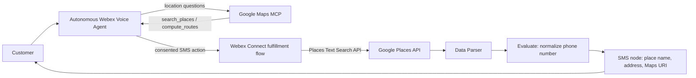

# Implement Google Maps MCP and SMS Fulfillment in a Webex Autonomous Voice Agent

## Summary

This playbook describes how to configure a Webex autonomous voice agent to find nearby locations and provide customers with location links by SMS. The agent uses Google Maps MCP tools for location search and route estimates. A separate Webex Connect fulfillment flow calls Places Text Search, parses place details, and sends a Google Maps place link by SMS.

The SMS flow sends a place link. It does not send turn-by-turn directions or calculate a route. When customers ask for route distance or travel time, configure the agent to use the MCP `compute_routes` tool and distinguish that response from the SMS place-search action.

## Owner and maintenance

- FDE owner: `sumanth2391`
- FDE Team Lead reviewer and maintaining team: FDE Team
- Last package review: 2026-11-11
- Version: 1.0.0
- Source engagement for internal traceability: [CCC-3762](https://imimobile.atlassian.net/browse/CCC-3762)

## Applicability

- Supported products: Webex Contact Center, Webex AI Agent Studio, Webex Connect, and Google Maps Platform
- Supported channels: Voice and SMS
- Intended audience: Webex Contact Center administrators and AI Agent/Flow Builder developers
- When to use: You want an autonomous voice agent to answer location or route questions and, with customer consent, text a Google Maps place link to the customer.
- Vertical applicability: Industry-neutral. Replace the organization or location search terms with values appropriate to your deployment.

## Try it fast

| Step | Do this | Where |
|---|---|---|
| 1 | Register the Google Maps MCP server using Streamable HTTP and `https://mapstools.googleapis.com/mcp`. | Webex for Developers / Control Hub |
| 2 | Enable billing and the required Maps Experience agent tools in Google Cloud. Create a restricted credential and store it in approved secret configuration. | Google Cloud Console |
| 3 | Configure the MCP connection with the `X-Goog-Api-Key` header. Enable the tools required by the use case, such as `search_places` and `compute_routes`. | Control Hub / Agentic Apps |
| 4 | Add a `send_location_sms` fulfillment action to the autonomous AI Agent. Require a location and valid mobile number, and obtain customer consent before sending. | Webex AI Agent Studio |
| 5 | Select the Webex Connect service and fulfillment flow for the action. | Webex AI Agent Studio |
| 6 | Configure the flow to call Places Text Search, parse the results, normalize the phone number, and send the SMS with the place link. | Webex Connect Flow Builder |
| 7 | Validate with synthetic locations and test phone numbers before enabling the use case for customers. | Webex Connect / AI Agent test environment |

## Export artifacts

| Artifact | File | Purpose |
|---|---|---|
| Webex Connect flow | [`95722.workflow`](exports/95722.workflow) | Starting flow export for Places Text Search, response parsing, phone normalization, and SMS fulfillment. Adapt tenant-specific configuration after import. |
| AI Agent action configuration | [`send-location-sms-action.png`](exports/send-location-sms-action.png) | Shows the `send_location_sms` action description, input slots, and fulfillment selection. |
| Setup guide | [`Google Maps MCP and Location SMS Guide.docx`](resources/Google%20Maps%20MCP%20and%20Location%20SMS%20Guide.docx) | Companion guide for setting up the Google Maps MCP connection and agent. |

## Architecture



The MCP connection and the SMS fulfillment flow are separate integrations. MCP exposes tools to the agent. The fulfillment flow makes its own Places Text Search REST request and sends the resulting place link through the configured SMS service.

## Prerequisites

- Access to Webex AI Agent Studio and the Webex Connect workspace.
- Permission to add an Agentic App and configure an autonomous AI Agent action.
- A Google Cloud project with billing enabled and Maps Experience agent tools enabled for MCP use.
- Places API (New) enabled for the fulfillment flow’s Text Search request.
- A restricted Google API key stored in approved secret configuration. Do not put the key in the agent prompt, exported flow, screenshots, or source control.
- A configured SMS sender and an approved way to obtain customer consent.
- A test environment, synthetic locations, and test phone numbers.

## Implementation

Use the following steps to register Google Maps MCP, configure Google Cloud, add the AI Agent action, and build the Webex Connect fulfillment flow.

### Register the Google Maps MCP server

1. Open the Webex for Developers portal and go to **My Webex Apps**.
2. Choose **Create New App**, then select **Onboard MCP**.
3. Configure the Agentic App:
   - **URL:** `https://mapstools.googleapis.com/mcp`
   - **Transport:** Streamable HTTP
   - **Name:** Google Maps MCP
   - **Authentication:** Custom Headers
4. Submit the Agentic App and wait for the submission confirmation.
5. In Control Hub, open **Apps > Agentic Apps** and select the submitted app.
6. In **Authentication**, configure the custom header `X-Goog-Api-Key` with the restricted Google API key as its value.
7. Save the configuration. In **Tools**, enable the tools required by the use case, such as `search_places` and `compute_routes`.

Treat MCP tool results as source data; the agent should not claim results the tools did not return. Retain Google Maps source links when presenting Maps results.

### Configure Google Cloud

1. Select or create the Google Cloud project that will own the integration.
2. Enable billing for the project.
3. Enable **Maps Experience agent tools** for MCP-based search and route tools.
4. Enable **Places API (New)** for the Webex Connect flow’s Places Text Search request.
5. Create or select an API key for the flow and restrict it to the APIs it needs. Store it securely in the flow configuration.

Google Maps MCP and Places Text Search use separate configured calls in this pattern. Confirm that the credential and API restrictions cover the services used by each request.

### Add the SMS fulfillment action

Create an AI Agent fulfillment action named `send_location_sms` and connect it to a Webex Connect flow.

| Input | Required | Purpose |
|---|---:|---|
| `location` | Yes | Customer-confirmed city, area, ZIP/postal code, or state used for the place search. |
| `maxresults` | No | Requested number of places. The example supports up to five. |
| `phonenumber` | Yes | Customer’s mobile number for the SMS. |

The action description should require explicit customer consent to receive locations by text and a valid mobile number before sending. Ask for clarification if the requested location is too broad to identify useful results.

Under **Fulfillment**, choose **Use Webex Connect Flow Builder**, then select the service and flow configured for the action. Service and flow names are tenant-specific.

### Configure the Webex Connect flow

#### HTTP Request: Places Text Search

Configure an **HTTP Request** node:

- **Method:** POST
- **Endpoint:** `https://places.googleapis.com/v1/places:searchText`
- **Headers:** `Content-Type: application/json`, `X-Goog-Api-Key: <restricted key>`, and `X-Goog-FieldMask: places.displayName,places.formattedAddress,places.googleMapsUri`
- **Body:** Use the confirmed location and requested result count from the AI Agent action.

Example request body:

```json
{
  "textQuery": "<organization> locations near $(n2.aiAgent.location)",
  "pageSize": $(n2.aiAgent.maxresults)
}
```

Replace `<organization>` with the organization or locations relevant to your deployment. Ensure `pageSize` is passed as a number and constrained to the maximum supported by the flow. The example action supports up to five results.

The field mask must include the fields consumed by later nodes, such as place display name, formatted address, and Google Maps URI. Google requires a field mask for Text Search; request only the fields needed by the application.

#### Data Parser: map place results

Parse the HTTP response body as JSON. Map each place result’s display name, formatted address, and Google Maps URI to named flow output variables. The example maps the first results returned by the API.

#### Evaluate: normalize the phone number

The Evaluate node removes formatting characters from the phone number and converts supported 10-digit or 11-digit North American numbers into `+1` E.164 format. The SMS node uses the resulting `phone_e164` value as its destination. Adapt the logic for other countries before using the pattern internationally.

#### SMS: send the place link

Configure the SMS node with the tenant’s SMS sender, text message type, and the `phone_e164` destination. Build the message from the parsed place name, address, and Google Maps URI.

The example maps and sends **one location**. To send more than one, add the additional place fields to the Data Parser and include those output variables in the SMS template. Keep the action’s stated maximum, parser mappings, and SMS contents aligned.

## Validation

Before using the flow with customers, test in a non-production environment and confirm:

- The HTTP request succeeds with the configured API key and required field mask.
- A specific city or postal code returns relevant locations.
- The configured result count matches the locations included in the SMS.
- The SMS contains the expected place name, address, and Google Maps URI.
- The action obtains customer consent and a valid mobile number before triggering fulfillment.
- Phone-number handling matches the countries supported by the deployment.
- API key restrictions, SMS sender configuration, usage monitoring, and cost controls are in place.

The package instructions have been reviewed. No independent live-tenant test result is included; perform the validation steps in the target organization before production use.

## Security and privacy

- Use a dedicated, restricted Google API key and store it in approved secret configuration.
- Do not include credentials, personal phone numbers, customer data, tenant IDs, production service names, sender numbers, or unredacted screenshots in the playbook package.
- Use synthetic locations and test numbers in validation examples.
- Obtain explicit customer consent before sending a location SMS.
- Review Google Maps Platform terms, attribution requirements, data retention, and organizational SMS policies before production use.

## Known scope

- This pattern sends Google Maps place links by SMS; it does not send turn-by-turn directions.
- The Google Maps MCP `compute_routes` tool can provide route distance and duration for agent responses. The SMS flow described here uses Places Text Search and sends a place URI.
- The phone normalization shown is for North America. International deployments must adapt validation and E.164 conversion.
- The included SMS example sends one location. Additional locations require matching Data Parser mappings and SMS template fields.

## Troubleshooting

| Symptom | Checks |
|---|---|
| No places are returned | Confirm the location input is specific enough, the Places API (New) is enabled, the API key is restricted to the correct API, and the HTTP request includes a valid field mask. |
| The HTTP request fails | Check the endpoint, POST method, JSON body syntax, `X-Goog-Api-Key` configuration, and Places API project billing and permissions. |
| The SMS is not sent | Confirm the customer consent and phone-number slots were collected, the `phone_e164` output is populated, and the selected SMS sender is enabled. |
| The SMS contains only one location | Add parser mappings for the additional place results and include those variables in the SMS template. |
| The destination number is invalid | The example normalization supports North American numbers only. Adapt validation and E.164 formatting for other countries. |

## References

- [Google Maps Platform: Maps Experience agent tools](https://developers.google.com/maps/ai/maps-experience-agent-tools)
- [Google Places API (New): Text Search](https://developers.google.com/maps/documentation/places/web-service/text-search)
- [Webex AI Agent Studio Administration Guide](https://help.webex.com/en-us/article/ncs9r37/Get-started-with-Webex-AI-Agent)
