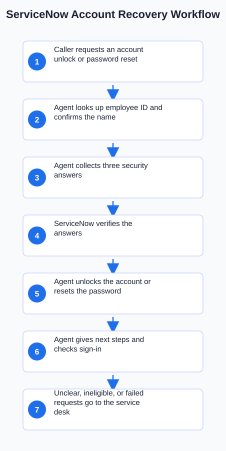

# ServiceNow Hosted Account Recovery MCP AI Agent

This reusable voice AI playbook helps employees regain work account access through a ServiceNow-hosted MCP server. The agent verifies the caller before unlocking an account or resetting a password, then checks whether sign-in worked or escalates to the service desk.

## Try It Fast

| Step | Do this | Where |
|---|---|---|
| 1 | Import [ServiceNow_Account_Recovery_AI_Agent.json](exports/ServiceNow_Account_Recovery_AI_Agent.json). | AI Agent Studio |
| 2 | Onboard or select a ServiceNow-hosted MCP server with OAuth 2.0 client credentials. | Control Hub / Agentic Apps |
| 3 | Rebind the MCP server ID, endpoint, authentication connection, and five tools listed below. | AI Agent Studio |
| 4 | Import [ServiceNow_Account_Recovery_Flow.json](exports/ServiceNow_Account_Recovery_Flow.json). | Flow Designer |
| 5 | Rebind the Agent activity and service-desk queue. ENDED disconnects; ESCALATE routes to the queue. | Flow Designer |
| 6 | If using the reference implementation, install the REST resources, configure the required role and verification property, and apply instance-specific ACLs. | ServiceNow |
| 7 | Test with synthetic employee records and answers in a nonproduction instance. | ServiceNow / Phone |
| 8 | Publish only to a test entry point until verification, reset, unlock, and handoff paths pass. | Webex Contact Center |

## What the Agent Does

1. Uses the employee ID collected by the greeting to look up an active account.
2. Confirms the caller's first and last name without revealing whether the record matched.
3. Retrieves three enrolled security questions and verifies the answers before checking account status or acting.
4. Unlocks an eligible locked account, resets an eligible password, or explains the available choice.
5. Reads the temporary password in a voice-friendly way, checks whether sign-in worked, and allows one additional reset before handoff.

The included verification script accepts at least two correct answers out of three. Confirm that this threshold matches the target organization's policy before use.

## ServiceNow-Hosted MCP Configuration

The Agent calls five tools on the ServiceNow-hosted MCP server. OAuth credentials belong in the approved tenant connection; this package contains no credentials or live endpoint.

| MCP tool | Reference REST resource | Purpose |
|---|---|---|
| lookup_user_record | GET /users?employee_id=... | Resolve one active record using a six-digit employee ID. The ID is a lookup value, not proof of identity. |
| retrieve_security_questions | GET /questions/{user_id} or GET /questions?user_id=... | Return active enrolled security questions. |
| verify_security_answers | POST /answers | Verify three answers for the same user; the included implementation passes at least two correct answers. |
| unlock_user_account | POST /unlock | Unlock an eligible account after verification. |
| reset_user_password | POST /reset | Set a temporary password and require a change at next sign-in. |

These resource paths are relative to the Scripted REST API base path in the target ServiceNow instance. No MCP server configuration export is included; create or select a compatible hosted MCP server and bind each tool to the target REST resource.

## Configure the ServiceNow MCP Server

See [servicenow-mcp-server-setup.md](resources/servicenow-mcp-server-setup.md) for the ServiceNow Console steps, REST resource and schema mapping, tool descriptions, access controls, and Webex authentication compatibility check.

**Production gate:** the included reset and unlock endpoints trust the AI-agent sequence and do not independently verify a successful security-answer check. Keep these mutation tools out of a production MCP server until ServiceNow enforces a server-side verification state for the same caller and session.

## Webex Contact Center Flow

The Flow Designer export starts a voice interaction, invokes the autonomous AI Agent, routes ESCALATE to a queue, and disconnects on ENDED. Rebind the organization, flow, Agent, and queue placeholders after import. Confirm the target queue is staffed and appropriate for account recovery.

## Architecture

The workflow diagram above shows the voice flow, autonomous Agent, ServiceNow-hosted MCP server, account and security-question APIs, and service-desk queue. The Agent invokes the MCP tools directly. The flow owns voice entry, Agent invocation, disconnect on completion, and queue handoff.

## Export Files

| JSON export file name | Detailed description |
|---|---|
| [ServiceNow_Account_Recovery_AI_Agent.json](exports/ServiceNow_Account_Recovery_AI_Agent.json) | AI Agent Studio voice agent with five ServiceNow MCP tools and native Agent handover. The MCP endpoint and server ID are placeholders; rebind endpoint, OAuth connection, server ID, and tool associations after import. |
| [ServiceNow_Account_Recovery_Flow.json](exports/ServiceNow_Account_Recovery_Flow.json) | Contact Center voice flow that invokes the Agent, routes ESCALATE to a placeholder service-desk queue, and disconnects on ENDED. Rebind organization, flow, Agent, and queue values. |
| [reset_user_password.schema.json](exports/servicenow/schemas/reset_user_password.schema.json) | Request schema for a temporary password reset for a verified eligible user. |
| [unlock_user_account.schema.json](exports/servicenow/schemas/unlock_user_account.schema.json) | Request schema for unlocking a verified eligible account. |
| [verify_security_answers.schema.json](exports/servicenow/schemas/verify_security_answers.schema.json) | Request schema for three question-and-answer pairs associated with the looked-up user. |

## ServiceNow Reference Implementation

The JavaScript files under [exports/servicenow/resources/](exports/servicenow/resources/) implement the five reference REST resources. They are optional when the target instance already exposes equivalent tools. Review the instance's fields, application scope, ACLs, caller role, password-reset enrollment, excluded roles, and security-question verification before installation.

| Reference file | Purpose |
|---|---|
| [lookup_user_record.js](exports/servicenow/resources/lookup_user_record.js) | Resolve one active user by employee ID and return account status for use after verification. |
| [retrieve_security_questions.js](exports/servicenow/resources/retrieve_security_questions.js) | Retrieve the user's active enrolled questions. |
| [verify_security_answers.js](exports/servicenow/resources/verify_security_answers.js) | Verify three answers. Set webexccai.pwd_reset.verification_id to the target instance's verification record sys_id. |
| [unlock_user_account.js](exports/servicenow/resources/unlock_user_account.js) | Unlock an eligible user and clear failed sign-in attempts when supported. |
| [reset_user_password.js](exports/servicenow/resources/reset_user_password.js) | Generate a temporary password and require a change at next sign-in. |

## Test Script

Use synthetic records in a nonproduction instance. [test-cases.md](resources/test-cases.md) covers verification, reset, unlock, retries, errors, and handoff. Do not test with real employee answers or production accounts.

## Import and Rebind Notes

- Import the Agent export and select the target MCP server.
- Rebind all MCP tools to that server and confirm the endpoint and OAuth connection.
- Import the flow and rebind the Agent activity and service-desk queue.
- Configure the reference implementation only if needed; its REST base path, role, properties, ACLs, and table fields are instance-specific.
- The verification script requires webexccai.pwd_reset.verification_id and fails closed if the property is missing or invalid.
- Confirm account eligibility rules and the two-of-three answer threshold with the target service owner.
- Validate the journey against synthetic records before production use.

## Security, Privacy, and Publishing Notes

- Never commit OAuth credentials, client secrets, bearer tokens, authentication headers, live ServiceNow URLs, or real employee records.
- Treat employee IDs, account status, security questions and answers, temporary passwords, and ServiceNow sys_ids as sensitive.
- Do not disclose account existence, status, recorded names, failed question details, internal IDs, or ineligibility reasons to callers.
- Do not pass security answers or temporary passwords to the human queue.
- Use approved secret storage for OAuth credentials and review logs and transcript retention for sensitive values.
- The public exports use placeholders for MCP, tenant, Agent, and queue bindings.

## Known Limitations

- No MCP server configuration export or API namespace/base path is included; configure these in the target instance.
- The GET tools have no separate request-schema files; their inputs are defined by the Agent export and reference scripts.
- Password-reset fields, enrollment tables, role names, ACL behavior, and system properties vary by ServiceNow instance.
- Runtime validation requires AI Agent Studio, Flow Designer, a compatible hosted MCP server, and a nonproduction ServiceNow instance.
